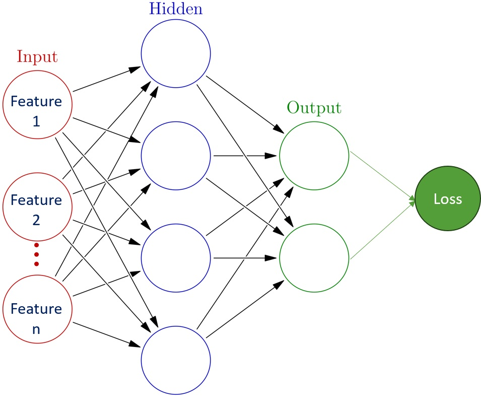
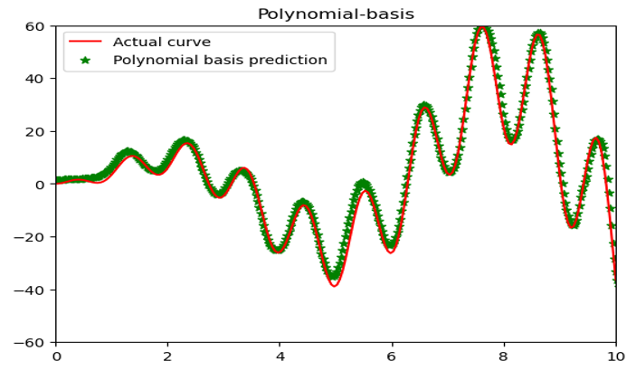
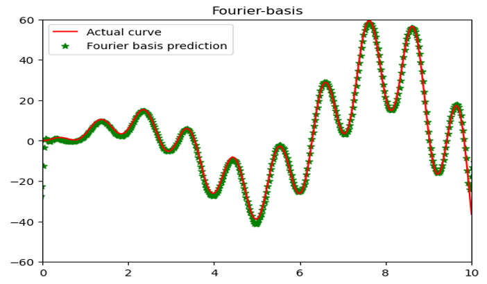
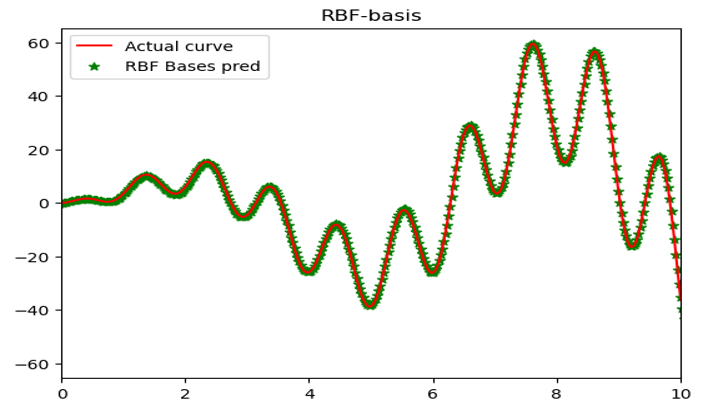
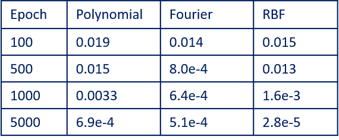
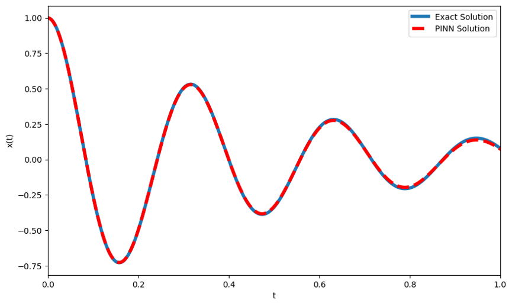

# Computational Formulation and Solution of Non-Linear Hyper-Elastic Continuum Solids using Deep Neural Networks

## Table of Contents

1. [Introduction](#introduction)
2. [Objectives](#objectives)
3. [Hyper-elasticity: Theory](#hyper-elasticity-theory)
4. [Methodology](#methodology)
5. [Function Approximation](#function-approximation)
6. [Linear ODE with an Oscillatory Solution](#linear-ode-with-an-oscillatory-solution)
7. [1D Elasticity](#1d-elasticity)
8. [Benchmark: Burgers' Equation (Raissi et al.)](#benchmark-burgers-equation-raissi-et-al)
9. [FEA Benchmark for Hyper-elasticity](#fea-benchmark-for-hyper-elasticity)
10. [List of Symbols](#list-of-symbols)

---

## Introduction

- Hyper-elastic models are used to simulate biomedical tissues, artificial organs, soft robots and a wide range of elastomers.
- Hyper-elasticity involves large deformations and non-linear constitutive relations, which makes the governing equations computationally challenging to solve.
- Conventional numerical methods such as the Finite Element Method (FEM) become expensive when many loading cases, geometries or material-parameter combinations must be solved.
- GPUs, automatic differentiation and modern deep-learning frameworks have made physics-informed learning practical.
- Physics-Informed Neural Networks (PINNs) combine available data with the governing differential equations and boundary conditions, so that physical knowledge can compensate for limited data.

## Objectives

- Formulate the hyper-elasticity problem using Physics-Informed Neural Networks (PINNs).
- Solve a range of non-linear hyper-elasticity problems with the PINN formulation.
- Solve the inverse problem to identify the constitutive law of a material.

---

## Hyper-elasticity: Theory

### Governing equations

The balance of linear momentum must be satisfied by every solid body, deformable or rigid:
```math
\begin{aligned}
\nabla \cdot \boldsymbol{\sigma} + \mathbf{b} &= \rho \ddot{\mathbf{u}} \\
\boldsymbol{\sigma} \cdot \mathbf{n} &= \boldsymbol{\tau} \quad \text{on } \Gamma_N \\
\mathbf{u}(\mathbf{x}_d) &= \mathbf{u}_0 \quad \text{on } \Gamma_D
\end{aligned}
\qquad (1)
```

For deformable bodies, Equation (1) must be supplemented by a **constitutive law**, which relates the stress developed in the body to its deformation.

### Strain-energy function

For an isotropic hyper-elastic material, the free-energy function must be objective (independent of rigid-body motion). This requires it to depend on the deformation only through the invariants of the right Cauchy–Green deformation tensor $\mathbf{C}$:

$$
\Psi = \Psi\big(I_1(\mathbf{C}),\, I_2(\mathbf{C}),\, I_3(\mathbf{C})\big)
$$

For compressible hyper-elastic materials, the energy must also grow without bound when the body is expanded infinitely or compressed to zero volume.

For a **compressible Mooney–Rivlin** material (with a quadratic volumetric penalty term), the free energy is

$$
\Psi = \frac{\mu_1}{2}\,(I_1 - 3) + \frac{\mu_2}{2}\,(I_2 - 3) + \frac{K_1}{2}\,(J - 1)^2
$$

where $I_n$ are the invariants of $\mathbf{C}$ and $J = \det(\mathbf{F})$.

> **Note:** the penalty term $(J-1)^2$ stays finite as $J \to 0$, so this simple form does not strictly satisfy the growth condition stated above. It is a common practical choice for nearly incompressible behaviour. A strictly admissible form uses a volumetric term that diverges as $J \to 0$ (for example one containing $\ln J$). For a truly incompressible material ($J = 1$), the penalty term is replaced by a Lagrange-multiplier pressure term.

### Stress measures

In non-linear solid mechanics it is convenient to work with power (rate of energy), since this makes it easier to step through time and solve for the deformation recursively. The rate of change of the free energy is

$$
\dot{\Psi} = \frac{\partial \Psi}{\partial \mathbf{F}} : \dot{\mathbf{F}}
$$

The first Piola–Kirchhoff stress $\mathbf{P}$ is the power conjugate of $\dot{\mathbf{F}}$, i.e. $\dot{\Psi} = \mathbf{P} : \dot{\mathbf{F}}$, so

$$
\mathbf{P} = \frac{\partial \Psi}{\partial \mathbf{F}}
$$

Similarly, in terms of the Green–Lagrange strain $\mathbf{E}$, the second Piola–Kirchhoff stress $\mathbf{S}$ follows from $\dot{\Psi} = \mathbf{S} : \dot{\mathbf{E}}$:

$$
\mathbf{S} = \frac{\partial \Psi}{\partial \mathbf{E}} = 2\,\frac{\partial \Psi}{\partial \mathbf{C}}
$$

Both can be converted to the Cauchy stress by a push-forward operation:

$$
\boldsymbol{\sigma} = J^{-1}\,\mathbf{P}\,\mathbf{F}^{T} = J^{-1}\,\mathbf{F}\,\mathbf{S}\,\mathbf{F}^{T}
$$

> **Why use $\mathbf{P}$ in the network?**
> It is preferable to write the equations in terms of $\mathbf{P}$ (the material form) when solving with a neural network. The network's inputs are material coordinates, so derivatives of the outputs with respect to those inputs can be taken directly. Converting the inputs to spatial coordinates using the predicted $\mathbf{F}$ would introduce additional approximation error.

### Material (Lagrangian) form of the equilibrium equation

$$
\nabla_{X} \cdot \mathbf{P} + \mathbf{b}_0 = \rho_0\, \ddot{\mathbf{u}}, \qquad
\mathbf{P} \cdot \mathbf{N} = \boldsymbol{\tau}_0 \ \text{on } \Gamma_N, \qquad
\mathbf{u} = \mathbf{u}_0 \ \text{on } \Gamma_D
$$

where $\nabla_X$ is the gradient with respect to the reference coordinates $\mathbf{X}$, $\rho_0$ is the reference density, $\mathbf{b}_0$ is the body force per unit reference volume, $\mathbf{N}$ is the outward normal in the reference configuration, and $\boldsymbol{\tau}_0$ is the nominal (first Piola–Kirchhoff) traction.

### One-dimensional case

In one dimension the deformation gradient is $F = 1 + \dfrac{\partial u}{\partial X}$ and the first Piola–Kirchhoff stress is $P = \dfrac{\partial \Psi}{\partial F}$. The equation reduces to

$$
\frac{\partial P}{\partial X} + b_0 = \rho_0 \frac{\partial^2 u}{\partial t^2}
$$

and for the static case:

$$
\frac{\mathrm{d}P}{\mathrm{d}X} + b_0 = 0
$$

For a linear-elastic bar, $P = E\,\dfrac{\mathrm{d}u}{\mathrm{d}X}$, which gives $\dfrac{\mathrm{d}^2u}{\mathrm{d}X^2} + \dfrac{b_0}{E} = 0$. In the [1D Elasticity](#1d-elasticity) section this is written in terms of the normalised body force $b^* = b/(EA)$, where $b$ is the body force per unit length of the bar.

---

## Methodology

The network takes the coordinate $x$ (or a set of basis-function features of $x$) as input and predicts the displacement field $\mathbf{u}$.

<p align="center">
  
  <br>
  <em>Figure 1: Architecture of the neural network used to predict the displacement field.</em>
</p>

Since the network outputs $\mathbf{u}$ as a function of position, the kinematic and stress quantities are computed from it using automatic differentiation:

$$
\mathbf{u} \;\rightarrow\; \mathbf{F} \;\rightarrow\; \mathbf{C} \text{ or } \mathbf{B} \;\rightarrow\; I_1,\, I_2,\, J \;\rightarrow\; \mathbf{P} \text{ or } \boldsymbol{\sigma}
$$

with $\mathbf{F} = \mathbf{I} + \nabla_X \mathbf{u}$, $\mathbf{C} = \mathbf{F}^T\mathbf{F}$ and $\mathbf{B} = \mathbf{F}\mathbf{F}^T$.

The network is trained by minimising a weighted sum of three losses. Each loss is shown in its spatial (Eulerian) form and in its material (Lagrangian) form. Because the network inputs are material coordinates, the **material form is the one used for training**.

### PDE residual loss

Spatial form:

$$
\mathcal{L}_{PDE} = \mathrm{MSE}\big(\nabla \cdot \boldsymbol{\sigma} + \mathbf{b} - \rho\\ddot{\mathbf{u}}, \mathbf{0}\big)
$$

Material form:

$$
\mathcal{L}_{PDE} = \mathrm{MSE}\big(\nabla_X \cdot \mathbf{P} + \mathbf{b}_0 - \rho_0\\ddot{\mathbf{u}}, \mathbf{0}\big)
= \frac{1}{N_f}\sum_{i=1}^{N_f} \left\| \nabla_X \cdot \mathbf{P}(\mathbf{X}_i) + \mathbf{b}_0(\mathbf{X}_i) - \rho_0\,\ddot{\mathbf{u}}(\mathbf{X}_i) \right\|^2
$$

### Traction (Neumann) loss

Spatial form:

$$
\mathcal{L}_{traction} = \mathrm{MSE}\big(\boldsymbol{\sigma} \cdot \mathbf{n},\ \boldsymbol{\tau}\big)
$$

Material form:

$$
\mathcal{L}_{traction} = \mathrm{MSE}\big(\mathbf{P} \cdot \mathbf{N},\ \boldsymbol{\tau}_0\big)
= \frac{1}{N_t}\sum_{j=1}^{N_t} \left\| \mathbf{P}(\mathbf{X}_j)\,\mathbf{N}_j - \boldsymbol{\tau}_0(\mathbf{X}_j) \right\|^2
$$

### Dirichlet (displacement) loss

The same expression applies in both forms, since the constrained points are identified by their material coordinates:

$$
\mathcal{L}_{Dirichlet} = \mathrm{MSE}\big(\mathbf{u}(\mathbf{X}_d),\; \mathbf{u}_0\big)
= \frac{1}{N_d}\sum_{k=1}^{N_d} \left\| \mathbf{u}(\mathbf{X}_k) - \mathbf{u}_0(\mathbf{X}_k) \right\|^2
$$

### Total loss

$$
\mathcal{L}_{total} = \lambda_1\,\mathcal{L}_{PDE} + \lambda_2\,\mathcal{L}_{traction} + \lambda_3\,\mathcal{L}_{Dirichlet}
$$

---

## Function Approximation

As a first step, we tested how well neural networks can approximate a non-linear function, and how the choice of input basis function affects the result. Three basis functions were used as input features:

- Polynomial basis
- Fourier basis
- Radial basis functions (RBF)

The target function was

$$
f(x) = 5x\sin(x) + 3x\sin(6x)
$$

All runs used the same number of input features (the basis terms $x^i$, $\sin(ix)$ and $\mathrm{RBF}(i, x)$ for $i = 1, \dots, \text{order}$) and the same number of epochs.

<p align="center">
  
  <br>
  <em>Figure 2: Function approximation using a polynomial basis.</em>
</p>

<p align="center">
  
  <br>
  <em>Figure 3: Function approximation using a Fourier basis.</em>
</p>

<p align="center">
  
  <br>
  <em>Figure 4: Function approximation using radial basis functions (RBF).</em>
</p>

<p align="center">
  
  <br>
  <em>Figure 5: Training-loss convergence for the polynomial, Fourier and RBF input features.</em>
</p>

**Observations**

- The **polynomial** basis struggles to fit the function accurately.
- The **Fourier** basis does not get below a loss of the order of $10^{-4}$. The most likely reason is a limitation of the features rather than the optimiser. The target contains terms of the form $x\sin(ix)$, which cannot be built from pure sine features $\sin(ix)$. A highly non-linear, oscillating loss landscape may also contribute. A combined polynomial and Fourier basis suits this function much better.
- The **RBF** basis converges to a low loss very well. RBFs output a curve that depends on the distance from a centre, which suits localised features. The choice of the centres also plays an important role in the quality of the solution.

---

## Linear ODE with an Oscillatory Solution

A PINN was used to solve a damped oscillator. Although the ODE is linear, its solution is a non-linear (oscillatory, decaying) function of time:

$$
\ddot{x} + 4\dot{x} + 400x = 0, \qquad x(0) = 1, \qquad \dot{x}(0) = 0
$$

The loss function that was minimised is

$$
\mathcal{L} = \lambda_1\,\mathrm{MSE}\big(m\ddot{x} + c\dot{x} + kx,\; 0\big) + \lambda_2\,\mathrm{MSE}\big(x(0),\; 1\big) + \lambda_3\,\mathrm{MSE}\big(\dot{x}(0),\; 0\big)
$$

with $m = 1$, $c = 4$ and $k = 400$.

<p align="center">
  
  <br>
  <em>Figure 6: PINN solution of the damped oscillator compared with the exact solution.</em>
</p>

This problem was solved fairly easily without any basis functions.

---

## 1D Elasticity

The 1D elasticity equation solved is

$$
\frac{\mathrm{d}^2 u}{\mathrm{d}x^2} + b^* = 0, \qquad b^* = \frac{b}{EA}
$$

with boundary conditions

$$
\left.\frac{\mathrm{d}u}{\mathrm{d}x}\right|_{x=L} = P^*, \qquad u\big|_{x=0} = 0, \qquad P^* = \frac{P}{EA}
$$

Here $b$ is the body force per unit length, $P$ is the force applied at the end $x = L$, $E$ is Young's modulus and $A$ is the cross-sectional area. The starred quantities are the forces normalised by the axial stiffness $EA$.

### Case 1: constant body force $b^*$

Integrating twice and applying the boundary conditions gives the exact solution

```math
u(x) = -\frac{b^{*} x^{2}}{2} + \left(P^{*} + b^{*} L\right) x
```

<p align="center">
  
  <br>
  <em>Figure 7: Deformation response for a constant body force.</em>
</p>

### Case 2: non-linear body force $b^* = b_0^* \sin\!\left(\dfrac{\pi x}{L}\right)$

The exact solution is

$$
u(x) = \frac{b_0^* L^2}{\pi^2}\,\sin\!\left(\frac{\pi x}{L}\right) + \left(P^* + \frac{b_0^* L}{\pi}\right)x
$$

<p align="center">
  
  <br>
  <em>Figure 8: Deformation response for a non-linear body force.</em>
</p>

### Observations

The constant- $b^*$ case was solved easily. For the non-linear $b^*$, convergence took longer. Two remedies work well:

1. Adjust the loss weights $\lambda_i$ so that the individual loss terms are of a similar order of magnitude (this is the simplest to implement).
2. Use a non-dimensionalised form of the equation.

---

## Benchmark: Burgers' Equation (Raissi et al.)

The results of Raissi et al. were reproduced with our methodology. Burgers' equation was solved in both its **continuous** and **discrete** (time-stepping) forms.

### Continuous form

The continuous form depends on both space and time, so it benefits greatly from a good sampling strategy. Following Raissi et al., we used **Latin Hypercube Sampling (LHS)**. LHS divides each dimension of the domain into equally probable intervals and picks one sample from each interval, then combines the samples across dimensions at random. This covers the multi-dimensional space more evenly than plain random sampling and gives better convergence with fewer sampling points.

<p align="center">
  
  <br>
  <em>Figure 9: PINN solution of the continuous-form Burgers' equation using Latin Hypercube Sampling.</em>
</p>

### Discrete form

In the discrete form, the neural network learns the non-linear solution only as a function of the space variable. The time dimension is handled by time stepping.

<p align="center">
  
  <br>
  <em>Figure 10: PINN solution of the discrete-form Burgers' equation (time stepping).</em>
</p>

---

## FEA Benchmark for Hyper-elasticity

Closed-form solutions are very hard to obtain for non-linear hyper-elastic materials, so the finite element method is used as the reference for such problems.

Two benchmarks were set up:

1. The analytical solution for the expansion of an **incompressible thin spherical balloon**.
2. The ANSYS benchmark problem of an **axisymmetric cylinder under internal pressure**.

Quadratic-order elements were used in both cases.

### Mesh convergence

- **Thin sphere:** mesh convergence was assessed using the radial stress at the mid-surface of the sphere wall.
- **Axisymmetric cylinder:** mesh convergence was assessed using the normal stress at the mid-surface.

<p align="center">
  
  <br>
  <em>Figure 11: Mesh convergence for the thin sphere (radial stress at the mid-surface).</em>
</p>

<p align="center">
  
  <br>
  <em>Figure 12: Mesh convergence for the axisymmetric cylinder (normal stress at the mid-surface).</em>
</p>

### Thin balloon (sphere) expansion

The analytical solution for the thin balloon expansion problem is taken from Yang Han et al., [*Benchmark Problems of Hyper-Elasticity Analysis in Evaluation of FEM*](https://doi.org/10.3390/ma13040885). Results are available only for an incompressible material ($J = 1$).

<p align="center">
  
  <br>
  <em>Figure 13: Problem description of the balloon expansion.</em>
</p>

<p align="center">
  
  <br>
  <em>Figure 14: Comparison of the FEA result with the analytical solution for the thin sphere.</em>
</p>

<p align="center">
  
  <br>
  <em>Figure 15: Thin sphere FEA results.</em>
</p>

### Axisymmetric cylinder under internal pressure

<p align="center">
  
  <br>
  <em>Figure 16: Problem description of the axisymmetric cylinder benchmark.</em>
</p>

<p align="center">
  
  <br>
  <em>Figure 17: Axisymmetric cylinder benchmark results compared with the ANSYS reference.</em>
</p>

---
### PINNs for Hyperelasticity

**In progress**
- [ ] PINN formulation for non-linear hyper-elasticity in 1D and 2D
- [ ] Validation of the PINN results against the FEA benchmarks
- [ ] Inverse problem for identifying the constitutive law

---

## List of Symbols

### Kinematics

| Symbol | Meaning |
|---|---|
| $\mathbf{x}$, $\mathbf{X}$ | Spatial (current) and material (reference) position vectors |
| $\mathbf{u}$ | Displacement vector, $\mathbf{u} = \mathbf{x} - \mathbf{X}$ |
| $\ddot{\mathbf{u}}$ | Acceleration (second time derivative of displacement) |
| $\mathbf{F}$ | Deformation gradient, $\mathbf{F} = \mathbf{I} + \nabla_X \mathbf{u}$ |
| $\mathbf{C}$ | Right Cauchy–Green deformation tensor, $\mathbf{F}^T\mathbf{F}$ |
| $\mathbf{B}$ | Left Cauchy–Green deformation tensor, $\mathbf{F}\mathbf{F}^T$ |
| $\mathbf{E}$ | Green–Lagrange strain tensor, $\tfrac{1}{2}(\mathbf{C} - \mathbf{I})$ (bold; not to be confused with Young's modulus $E$) |
| $J$ | Volume ratio, $\det(\mathbf{F})$; $J = 1$ for an incompressible material |
| $I_1,\, I_2,\, I_3$ | Principal invariants of $\mathbf{C}$ |
| $\nabla$, $\nabla_X$ | Gradient with respect to spatial and material coordinates |

### Stress and energy

| Symbol | Meaning |
|---|---|
| $\boldsymbol{\sigma}$ | Cauchy (true) stress |
| $\mathbf{P}$ | First Piola–Kirchhoff (nominal) stress, $\partial\Psi/\partial\mathbf{F}$ |
| $\mathbf{S}$ | Second Piola–Kirchhoff stress, $\partial\Psi/\partial\mathbf{E}$ |
| $\Psi$ | Helmholtz free (strain) energy per unit reference volume |
| $\dot{\Psi}$ | Rate of change of the free energy (stress power) |
| $\mu_1,\, \mu_2$ | Mooney–Rivlin material constants |
| $K_1$ | Volumetric (penalty) stiffness |

### Loading, geometry and boundary conditions

| Symbol | Meaning |
|---|---|
| $\rho$, $\rho_0$ | Mass density in the current and reference configurations |
| $\mathbf{b}$, $\mathbf{b}_0$ | Body force per unit current and per unit reference volume |
| $\mathbf{n}$, $\mathbf{N}$ | Outward unit normal in the current and reference configurations |
| $\boldsymbol{\tau}$, $\boldsymbol{\tau}_0$ | Prescribed traction (per unit current area) and nominal traction (per unit reference area) |
| $\Gamma_N$, $\Gamma_D$ | Neumann (traction) and Dirichlet (displacement) boundaries |
| $\mathbf{x}_d$, $\mathbf{X}_d$ | Points on the Dirichlet boundary (spatial and material coordinates) |
| $\mathbf{u}_0$ | Prescribed displacement on the Dirichlet boundary |

### Neural network and loss

| Symbol | Meaning |
|---|---|
| $\mathcal{L}_{PDE}$ | PDE (momentum balance) residual loss |
| $\mathcal{L}_{traction}$ | Traction boundary-condition loss |
| $\mathcal{L}_{Dirichlet}$ | Displacement boundary-condition loss |
| $\mathcal{L}_{total}$ | Weighted total loss |
| $\lambda_1,\, \lambda_2,\, \lambda_3$ | Loss weights |
| $N_f,\, N_t,\, N_d$ | Number of collocation points for the PDE, traction and Dirichlet losses |
| $\mathrm{MSE}$ | Mean squared error |
| $\mathrm{RBF}(i, x)$ | The $i$-th radial basis function evaluated at $x$ |

### Simple test problems

| Symbol | Meaning |
|---|---|
| $f(x)$ | Function used for the basis-function approximation test |
| $x(t)$ | Displacement of the damped oscillator |
| $m,\, c,\, k$ | Mass, damping coefficient and stiffness of the oscillator |
| $L$ | Length of the 1D bar |
| $E$ | Young's modulus of the bar (plain, not bold) |
| $A$ | Cross-sectional area of the bar |
| $P$ | In the 1D Elasticity section only: force applied at the end $x = L$ (elsewhere $\mathbf{P}$ is the first Piola–Kirchhoff stress) |
| $b$, $b^*$ | Body force per unit length of the bar, and its normalised value $b/(EA)$ |
| $P^*$ | Normalised end force, $P/(EA)$ |
| $b_0^*$ | Amplitude of the normalised sinusoidal body force |
